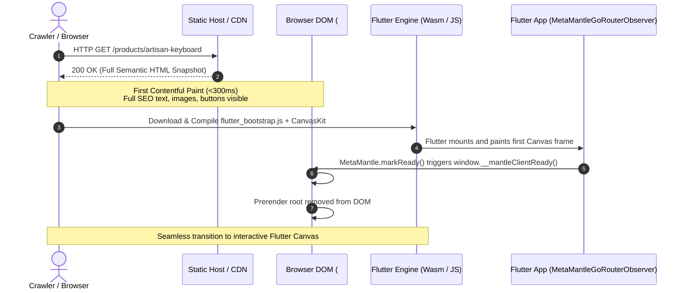

# MetaMantle Build Modes & Hydration Architecture

MetaMantle supports three primary compilation and rendering modes configured via CLI (`dart run meta_mantle build-web --mode=<metadata|prerender|hybrid>`) or programmatically via `BuildWebOptions(mode: ...)`.

---

## 1. Build Modes Overview

| Mode | Option Flag | HTML Injected | Client Handshake Script | Primary Use Case |
|---|---|---|---|---|
| **Mode A: Metadata** | `--mode=metadata` | `<head>` metadata, Open Graph, Twitter cards, JSON-LD, Canonical | None | Simple Flutter SPAs that only need social sharing tags and basic search indexing without pre-rendered DOM bodies. |
| **Mode B: Prerender** | `--mode=prerender` | Full `<head>` tags + semantic body HTML inside `#mantle-prerender-root` + styles | None | Static sites, read-only content, headless static page generation, or pure universal web applications. |
| **Mode C: Hybrid** | `--mode=hybrid` *(Default)* | Full `<head>` tags + semantic body HTML inside `#mantle-prerender-root` + styles | `window.__mantleClientReady()` coordination script (`#mantle-startup-bridge`) | Production Flutter Web applications requiring instant First Contentful Paint (<300ms), 100% crawlability, and zero layout shift or white screens. |

---

## 2. Architectural Analysis: Hydration vs. Snapshot Replacement

A common misconception in web frameworks is that Flutter Web CanvasKit or Wasm can perform "DOM Hydration" in the traditional React/Vue/Jaspr sense. It is critical to understand why MetaMantle distinguishes between **DOM Hydration** and **Snapshot Replacement with Coordinated Handshake**:

### Why Flutter Web (CanvasKit / Skwasm) Cannot Perform DOM Hydration

1. **Pixel-Based Canvas Rendering**:
   In Flutter Web's CanvasKit and Skwasm (Wasm-GC) rendering backends, Flutter compiles Dart widgets into a display list executed directly on an HTML5 `<canvas>` element (or WebGL2 context). Flutter controls every pixel on this canvas; it does *not* map widgets into HTML DOM elements (`<div>`, `<p>`, `<span>`, `<button>`).
2. **Absence of Host DOM Trees**:
   Because there is no live HTML DOM tree representing Flutter's widget hierarchy at runtime, Flutter's engine cannot "hydrate" or attach event listeners to pre-existing HTML DOM nodes rendered on the server. Attempting to force Flutter to attach to static DOM nodes is architecturally incompatible with CanvasKit.

### Mode B in Universal Web Runtime: True DOM Hydration

When using MetaMantle's lightweight **Universal Web DOM Runtime** (`runMantleApp(app, hydrate: true)` via Engine B), **true DOM hydration is performed**:
- The server or static generator marks semantic HTML nodes with stable deterministic identifiers (`data-mm-id="0.1.2"`).
- In the browser, `MantleHydrator` traverses the pre-rendered DOM tree without destroying or re-creating nodes.
- Dart event listeners (`onClick`, `onInput`) and reactive state observers are wired directly to the existing HTML elements.
- Initial paint is preserved with zero DOM reconstruction.

### Mode C in Flutter Web: Snapshot Replacement with Coordinated Handshake

For standard Flutter Web applications, MetaMantle solves the SEO and FCP problem using **Snapshot Replacement with Coordinated Handshake**:



#### Step-by-Step Handshake Lifecycle:

1. **Build Time**:
   During `dart run meta_mantle build-web --mode=hybrid`, MetaMantle resolves all routes from `StaticRouteManifest` and renders the consumer's `MantleComponent` tree into clean, accessible HTML. This markup is wrapped in `<div id="mantle-prerender-root">` and placed at the top of `<body>`.
2. **Initial Load (FCP)**:
   When a user or search engine crawler (Googlebot, Bingbot, Yandex) loads the URL, the browser immediately parses and renders `#mantle-prerender-root`.
   - Crawlers index genuine `<h1>`, `<p>`, `<nav>`, `<article>`, `<button>`, and `<a>` elements with exact schema markup.
   - Users see meaningful content immediately without seeing a blank white page while Flutter downloads large WebAssembly bundles.
3. **Background Engine Boot**:
   In parallel, `flutter_bootstrap.js` loads the Flutter WasmGC or CanvasKit engine and compiles shaders in the background.
4. **Coordinated Handshake**:
   When Flutter renders its very first active frame, `MetaMantleGoRouterObserver` (or `MetaMantle.markReady()`) notifies the window by calling:
   ```javascript
   window.__mantleClientReady();
   ```
5. **Smooth Fade-Out Transition**:
   The injected `#mantle-prerender-style` applies a smooth CSS transition:
   ```css
   #mantle-prerender-root.mantle-fade-out {
     opacity: 0;
     transition: opacity 0.25s ease-out;
     pointer-events: none;
   }
   ```
   After 250ms, the static container is cleanly unmounted from the DOM, leaving Flutter's interactive canvas in control.
6. **Fail-Safe Fallback Safeguard**:
   To prevent deadlocks if client JavaScript crashes or network issues delay Flutter initialization, `#mantle-startup-bridge` arms a fallback timer (default: 8000ms). If `__mantleClientReady` is not called within the timeout, the static prerender snapshot remains visible so the user is never left stranded on a blank canvas.

---

## 3. Strict Mode Verification

In CI/CD environments, enable `--strict` to prevent deployment of broken or incomplete pages:

```bash
dart run meta_mantle build-web --mode=hybrid --strict
```

Under `--strict`:
- Any route without a valid `<title>` triggers a build error.
- Any route missing a component tree or HTML content throws a `FormatException` halting compilation.
- HTML validation errors (unclosed tags, invalid nesting) abort the build.
- Missing images or broken internal asset references fail the build.
